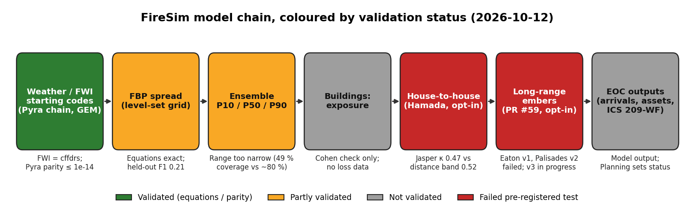

# FireSim: overview (2026-10-12)

A short summary of the whole development for Travis and the people he briefs (EOC staff,
managers). The detail, with every source, is in [`PROJECT_RECORD.md`](PROJECT_RECORD.md). Report
tags such as [R10] point to its report list ([§4.2](PROJECT_RECORD.md#42-references)); [R31]-[R33] are the long-range ember reports of PR #59 (not merged) and [R34] the ODB footprints report (PR pending).

- **App:** https://wildfire-simulator.vercel.app · **API:** https://firesim-api.fly.dev/api/v1/health
- **Code:** https://github.com/Tphambolio/wildfire-simulator (branch `master`)

## 1. What FireSim is

FireSim models wildfire growth with the Canadian Fire Behaviour Prediction (FBP) System. It
shows when and where a modelled fire reaches neighbourhoods, communities, critical assets, roads
and buildings.

- **It is a preparedness and training tool** for the EOC Planning section: exercises,
  tabletop scenarios and what-if planning. **It is not an operational forecast.** On held-out
  fires its one-day overlap with the real growth is low (§3), so it does not replace the lead
  agency's prediction.
- **Audiences:**
  - the EOC Planning section (Situation Unit, Plans Chief), who are the primary users;
  - emergency management and fire officers trained in the FBP System;
  - exercise designers and trainers.
- **What it never does:** suggest evacuation Order / Alert / Watch. Planning sets the status, and
  the app only draws it. It also gives no firefighter, aircraft or RPAS safety distances and no
  per-building loss forecast.
- **The later goal** is real-time prediction at the level of Prometheus/WISE, but only once the
  validation supports it (§1 of the record).

## 2. What it does today (live)

- **Fire weather.** Starting FWI codes come from Pyra's chain for the nearest Alberta station.
  The hourly forecast is Environment Canada's GEM model, through Open-Meteo. Users can enter
  codes themselves.
- **Spread.** The FBP System runs on a level-set grid, at 50 m cells and 20 m near buildings.
  Defaults include a burning period, FFMC spin-up and RPAS active edges. Multi-day runs carry
  the FWI codes over from day to day.
- **Fuel.**
  - In Edmonton: the City canopy-LiDAR fuel grid.
  - Elsewhere in Alberta: the Alberta Wildfire FBP fuel grid (2025, 100 m) [R24], [R35].
  - Terrain outside Edmonton: NRCan MRDEM-30 [R29].
- **Ensemble.** P10/P50/P90 arrival times and burn probability, calibrated on Alberta fires.
  The live API runs one ensemble at a time.
- **Exposure and arrivals.**
  - Arrival within 500 m for neighbourhoods, counties, hamlets and localities [R36].
  - Arrivals at critical assets and major roads across Alberta [R29].
  - Building exposure by distance band and radiant flux.
- **House-to-house spread** (opt-in, labelled "Illustrative"): Hamada building-to-building
  spread, ember ignition, burn-out, and a vegetation bridge and roof scenario.
- **EOC console.** ICS Canada 209-WF with MODEL OUTPUT tags, ICS forms and operational periods.
  Every output is stamped with the run ID and model version.
- **Run archive.** Finished runs survive deploys on a 1 GB Fly volume [R30].

## 3. Validation scorecard

**Status key:**
- **Validated:** matches its reference (equations or parity).
- **Partly validated:** tested on observed fires with real but limited skill.
- **Not validated:** never scored against observed outcomes.
- **Failed test:** missed its pre-registered decision rule.

All intervals are 95 % CIs.

| Component | Status | Key evidence | Ref |
|---|---|---|---|
| FBP engine (equations) | **Validated** (verification) | Matches CFS `cffdrs` to float precision. FBP: 12,960 cases, relative difference ≤ 3e-10. Daily FWI: FFMC/ISI/DC ≤ 1e-13. Spread area is 0.91-1.07 × the FBP ellipse for any wind angle. WISE comparison: area ratio 0.955-1.09. This shows the equations are right, not that predictions match real fires. | `verification.md` §1-3; [R5] |
| Fire growth on observed fires (single run) | **Partly validated** | 143 fire-days on 32 Alberta fires. Held-out one-day F1 rose 0.118 → 0.208 (+0.091, CI +0.056 to +0.125) with active edges, spin-up and a 10-20 h burning period; 0.212 after the diagonal fix. That is level with WISE defaults (0.26 nationally) and short of tuned WISE (0.54). Area is still over-predicted (+0.27), and the largest wind-driven runs are under-predicted. | `validation.md`; [R5] |
| Ensemble P10/P50/P90 | **Partly validated** (over-confident) | 65 held-out fire-days. The observed area falls inside P10-P90 on 49 % of days (ideal about 80 %). CRPS skill vs the single run is +0.24. Spread/skill is 1.6, so the range is too narrow. Cells at about 95 % burn probability burned 33 % of the time. **P10 is not a worst case:** it held at least 90 % of the observed growth on only 29 % of days. No CIs were computed for these scores. | `validation.md` "Ensemble calibration" |
| Edmonton fuel grid (City LiDAR) | **Not validated** | It has never had an accuracy assessment, and no field check exists. The open-data grid agrees with it at κ 0.56 (six classes), which measures agreement, not accuracy. About 3,173 ha south of 41 Ave SW is mapped non-fuel over cropland. | [R2], [R17] |
| Open-data fuel grid (v1, v2.1; not used by the app) | **Partly validated** (no better than the national grid) | Pre-registered northern Alberta fire test: held-out F1 0.192 vs 0.212 for the national 2014b grid (ΔF1 −0.020, CI −0.066 to +0.023, no detectable difference). It beat CFS 2026 (+0.021, CI +0.002 to +0.044). It maps 64 % of the fire areas as O-1b. v2.1 against pure stands: balanced accuracy 0.70 in Edmonton, but the north goal was not met. | [R17], [R26], [R27] |
| Alberta Wildfire fuel grid (default outside Edmonton) | **Not validated** (one test void) | Its own metadata gives accuracy as "unknown". An indicative check gave F1 0.287 → 0.295 on 7 fire-days, confounded and not a skill estimate. Masked on the northern test, it scored 0.160 (−0.052, CI −0.104 to −0.006); that was not pre-registered and is a lower bound, because recent burns are re-typed. The pre-registered 2025 burn test of code 105 was **void**: 25 of 29 fires failed the map-timing gate. | [R24], [R27], [R35] |
| Grass curing default (95 % from day 60 to 149) | **Partly validated** (neutral; grass barely tested) | Held-out F1 0.2126 → 0.2120 (ΔF1 −0.0007, CI −0.0017 to −0.0000). Grass is only 3.4 % of the observed growth, so the 95 % value cannot really be tested. The O-1b-all-year rule is decided but untested on Alberta grass fire-days. | [R14], [R35] |
| Multi-day runs | **Not validated** | Code-level checks only: QA, bug fixes and E2E tests. Frames are bit-identical after the speed fix. No multi-day growth has been scored against observed fires. | [R20], [R28] |
| Structure spread: Hamada (opt-in) | **Failed test** | Jasper 2024 (pre-registered): κ 0.472 vs 0.516 for a distance band (difference −0.044, CI −0.157 to +0.045). Precision is 63 % and recall 68 %. Given where the embers entered, Hamada does no better than distance. | [R10] |
| Structure: burn-out | **Failed test** (no effect) | At Jasper it was identical to Hamada in 11 of 12 runs. At the 45 m cutoff the difference was −0.008 (CI −0.035 to +0.010). | [R19] |
| Structure: 20 m WUI window | Not validated (model behaviour) | Front-contact gap fell from a median 22-42 m to 9-15 m. Edmonton areas rose 0 % to +410 % from finer fuel detail. It has never been rerun against observed losses. | [R18] |
| Structure: vegetation bridge | **Failed test** | Eaton 2025 (independent): bridge κ −0.021 vs Hamada −0.019 (difference −0.002, CI −0.010 to +0.003). The rule was also not met at Camp or Jasper. It is not adopted. | [R23] |
| Structure: roof scenario and short-range embers | **Failed test** (inert) | No building was ignited by embers in any run: 17 runs at Jasper, 42 in Edmonton, and every roof run at Jasper, Eaton and Camp. κ is unchanged. | [R16], [R23] |
| Long-range embers (PR #59, not merged) | **Failed test**; v3 in progress | v1 on Eaton (pre-registered) met 1 of 3 conditions: κ 0.115 vs windward seeding 0.162, and BSS vs base rate −0.53. v2 on Palisades (pre-registered, independent) met 2 of 3: the Brier difference vs Chen & McAneney was +0.061 (CI −0.011 to +0.131), AUC 0.499, and buildings at P ≥ 0.9 were 60 % destroyed. v3 is calibrated, but its leave-one-fire-out held-out BSS is negative on all three fires (Eaton −0.30, Palisades −0.31, Camp −2.58; coordinator, no report yet). It is not validated and work continues. | [R31], [R32], [R33] |
| Building exposure (radiant flux, distance bands) | **Not validated** | It reproduces Cohen (2004) worked values within 3.5 %. It uses worst-case radiant assumptions and ignores embers and yard fuels. It reports exposure, not ignition. | `verification.md`, `model-card.md` |
| Pyra starting codes | **Validated** (parity) | Identical to Pyra's engine to ≤ 1e-14 on 15 recorded cases and live for 4 Alberta stations. This shows the same numbers, not better ones. Known differences are listed in [R15] and §6 of the record. | Record §3, §5; [R15] |

## 4. Major owner decisions

- **No evacuation-tier suggestions, ever.** Planning sets Order / Alert / Watch, and they are
  drawn as blue outlines.
- **Preparedness first.** The tool is labelled a planning tool, not a forecast. "Worst-credible"
  was removed from P10.
- **Pre-register every test.** The rules are committed before scoring, the decision rule is
  applied as written, and failures are reported.
- **Per-house display only for exercises.** Involved buildings are shown on the map with an
  "Illustrative" badge (D3 was reversed on 2026-10-10). They never appear in exports or the
  209, and no addresses are shown. Units over 60,000 report "not computed".
- **Opt-in illustrative features.** House-to-house spread, embers, the vegetation bridge, the
  roof scenario and long-range embers are all off by default and labelled.
- **No unsourced numbers.** That covers WUI multipliers, the RPAS stand-off and the HFI→ICS
  sizing; all three are removed or off. No SFOC numbers appear in the repo.
- **ICS Canada 209-WF**, not NIMS.
- **Fuel.** The City LiDAR grid in Edmonton and the Alberta Wildfire grid elsewhere. O-1b all
  year and 105 as non-fuel [R35]. The open-data grid is scripts only.
- **Cost and infrastructure.** No Cloudflare/R2. A 1 GB Fly volume holds the run archive. Fly
  spend stays under about $1/month. One ensemble runs at a time (PR #68).
- **Structure literature.** The Berkeley/UMD model is rebuilt from published papers only;
  ELMFIRE source is never read (licence).

## 5. Data sources (licences)

| Data | Licence |
|---|---|
| City of Edmonton canopy-LiDAR FBP fuel grid; neighbourhoods; uPLVI | City of Edmonton (grid internal); OGL – Edmonton |
| Alberta Wildfire FBP fuel types 2025 (100 m) | OGL – Alberta (written confirmation recommended, [R35]) |
| NRCan MRDEM-30 terrain; CGNDB place names | OGL – Canada |
| Microsoft Canadian Building Footprints (Alberta 2019) | ODbL |
| StatCan ODB v3 municipal footprints (in progress, [R34]) | per-municipality OGL-type |
| StatCan census subdivisions, designated places; ODHF health facilities | Statistics Canada Open Licence; OGL – Canada |
| Alberta hamlet boundaries, urban service areas | OGL – Alberta |
| OpenStreetMap (assets, roads) | ODbL |
| Meta/WRI 1 m canopy height (building vegetation) | CC BY 4.0 |
| CWFIS weather/FWI; Open-Meteo GEM forecast; Pyra carry-over | Government of Canada open data; Open-Meteo terms; Pyra (team app) |
| CFSDS fire progressions (validation); CAL FIRE DINS (structure tests) | as listed in [`data-sources.md`](data-sources.md) and record §4.3 |

## 6. Known limits that matter operationally

- **One-day skill is low.** The held-out F1 is about 0.21. Read runs as a range or an upper
  envelope, not tomorrow's perimeter.
- **The ensemble is too narrow, and P10 is not a worst case.**
- **No suppression is modelled.** The burning period is a fixed clock window.
- **Fuel maps:**
  - The Edmonton grid has no accuracy assessment.
  - The Alberta grid maps little vegetation inside towns.
  - The Alberta grid treats cropland and recent burns as non-fuel, so modelled fire can stop
    where real spring or fall fire would continue.
- **House-to-house spread and embers failed their tests.** Use them for exercises only,
  never as a loss forecast.
- **Buildings outside Edmonton** are mostly Microsoft 2019 footprints. Coverage is uneven, and
  newer houses are missing.
- **Weather.** Starting codes come from one station chain, and wind direction is the largest
  source of error.

## 7. What's next

- **Long-range embers v3** (PR #59): building-to-building ignition probability by separation,
  building survival and an end to the wind-driven run, calibrated on Eaton, Camp and Palisades.
  A fresh pre-registered test on Tubbs 2017 and Woolsey 2018 follows. The current held-out BSS
  is negative, so it is not validated.
- **ODB municipal footprints** [R34]: PR pending. Edmonton box decision: drop the limit.
- **Ensemble.** Remove the shared over-prediction bias before widening the ensemble further.
  Measure RPAS-corrected mid-day restarts.
- **Fuel.** Field accuracy check of the fuel grids. A seasonal fuel switch in the City grid.
  Test code 105 on 2026+ fires against the frozen grid.
- **Licence.** Send the licence and build-rule request to Alberta Wildfire GIS [R35] (owner).

## 8. Where to find details

- [`PROJECT_RECORD.md`](PROJECT_RECORD.md):
  - [§3 Decisions](PROJECT_RECORD.md#3-decisions-log)
  - [§4.4 Validation results](PROJECT_RECORD.md#44-validation-results-summary-updated-2026-10-12)
  - [§6 Open items](PROJECT_RECORD.md#6-open-items)
  - [§4.2 Reports R1-R36](PROJECT_RECORD.md#42-references)
- [`validation.md`](validation.md), [`verification.md`](verification.md), [`model-card.md`](model-card.md)
- [`structure-spread-spec.md`](structure-spread-spec.md), [`fuel-grid-alberta.md`](fuel-grid-alberta.md),
  [`run-archive.md`](run-archive.md), [`data-sources.md`](data-sources.md)
- Reports: `~/dev/wildfire/reports/` (internal, not in the repo)
- Claude for Science project `proj_4c36553a0c0c` (snapshots of the record and the reports)
